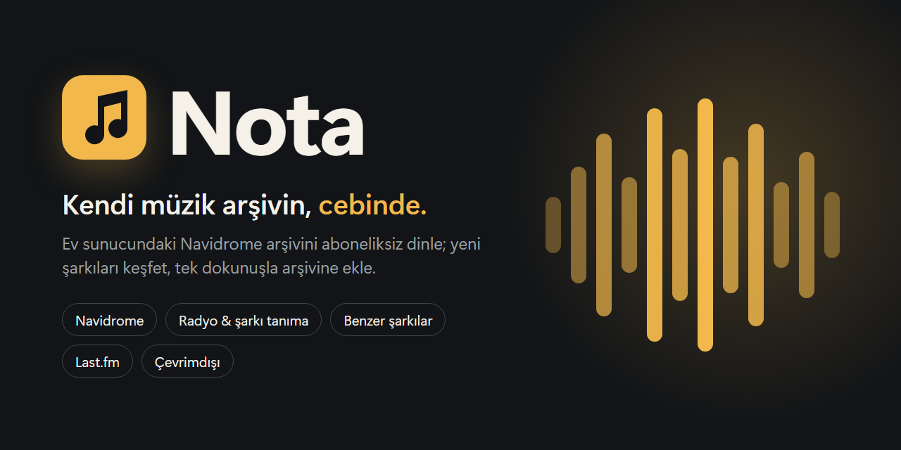
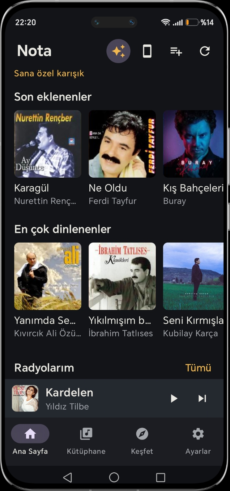
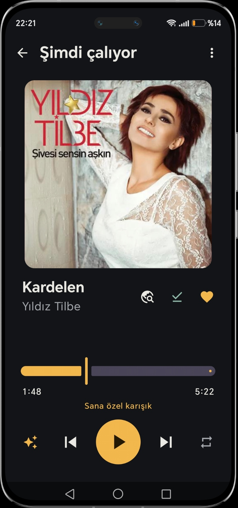
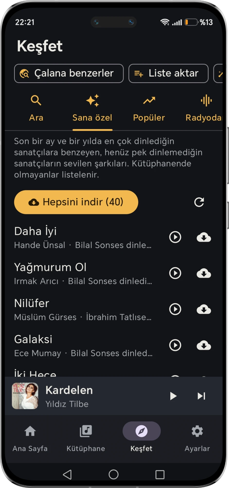
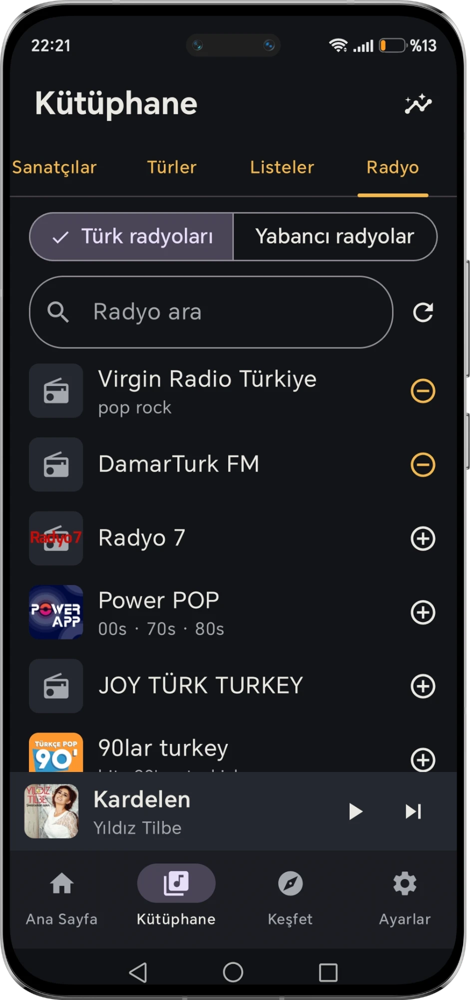
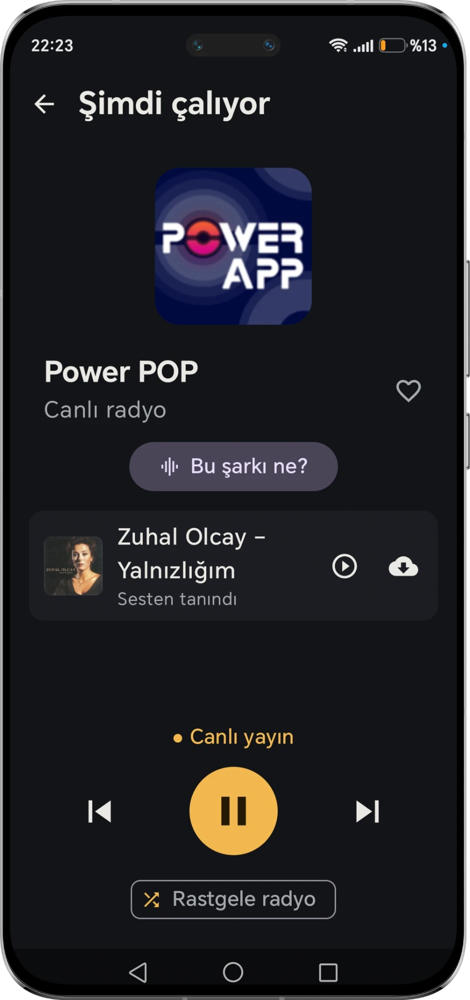
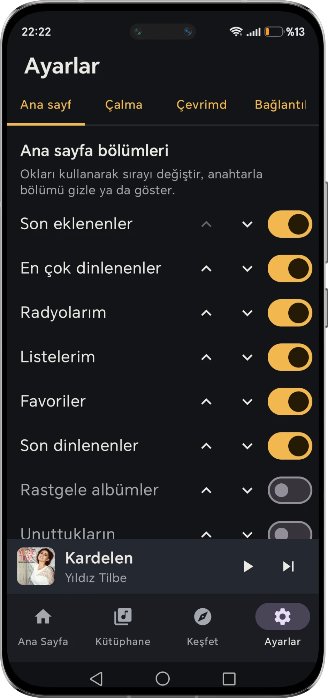

# Gurfy Sync

**Kendi müzik arşivini cebine taşıyan Android müzik uygulaması.**

Gurfy Sync, evdeki sunucunda duran müzik arşivini ([Navidrome](https://www.navidrome.org/)) telefonundan
dinlemeni sağlar. Spotify ya da YouTube Music gibi aylık abonelik ödemezsin; müzik senin
diskinde durur. Gurfy Sync bunun üstüne de keşfi kolaylaştırır: sevdiğin şarkılara benzerlerini bulur,
radyoda duyduğun şarkıyı tanır ve tek dokunuşla arşivine ekler.

## Ekran görüntüleri

<table>
  <tr>
    <td align="center"> Ana sayfa</td>
    <td align="center"> Şimdi çalıyor</td>
    <td align="center"> Keşfet: sana özel öneriler</td>
  </tr>
  <tr>
    <td align="center"> Radyolar</td>
    <td align="center"> Radyoda şarkı tanıma</td>
    <td align="center"> Ayarlar</td>
  </tr>
</table>

## Neler yapabilirsin?

### 🎵 Dinle
- Albüm, sanatçı, tür ve çalma listelerine göre düzenlenmiş kütüphane
- Ekran kapalıyken ve başka uygulamadayken kesintisiz çalma
- Telefona indirip internetsiz dinleme; en çok dinlediklerin kendiliğinden telefona iner
- Telefonun kendi müzikleri de "Telefondakiler" ekranında, arşivden indirilenlerle birlikte çalınır
- Tekrar (kapalı / liste / tek şarkı), karışık çalma ve şarkılar arası yumuşak geçiş (crossfade)
- **Sana özel karışık:** favorilerin, sık dinlediklerin, sevdiğin türler ve uzun süredir
  açmadıkların karışık bir listede. Sürekli geçtiğin şarkılar listeye bir daha girmez.
- Şarkıların türünü elle ekleme ve değiştirme
- Ayarların sunucuda yedeklenir: uygulamayı silip yeniden kurunca servis parolasını girmen yeter

### 📻 Radyo
- Türkiye'nin radyoları ve dünyanın en çok dinlenen 50 radyosu, tek listede ve aranabilir
- Favori radyolar, istasyonlar arasında ileri/geri geçiş, rastgele radyo
- Yayında çalan şarkının adı ekranda
- **Bu şarkı ne?** Radyoda çalan şarkıyı tanır, tek dokunuşla arşivine indirir.
  Tanınan şarkılar "Radyoda duyduklarım" listesinde birikir.

### 🔍 Keşfet
- Kütüphanede, radyolarda ve internette aynı anda arama; arşivinde olmayanları önce dinleyip sonra indirme
- Çalan şarkıya benzerler ve popüler listeler
- Spotify ve YouTube listelerini bağlantısıyla içeri aktarma; eksik şarkılar arşive iner
- İndirmelerin durumunu takip etme, hatalıları tekrar deneme

### 📊 Last.fm ve ListenBrainz
- Dinlediğin şarkılar Last.fm hesabına işlenir (internet yokken de kaydedilir, sonra gönderilir)
- Dinleme geçmişine göre öneriler, "Unuttukların" listesi ve dinleme istatistiklerin
- Benzer sanatçılar Last.fm ve [ListenBrainz](https://listenbrainz.org)'den birlikte bulunur; ikisinin de
  önerdiği sanatçılar öne çıkar, Last.fm'in bilmediği sanatçılarda ListenBrainz boşluğu doldurur
- ListenBrainz kullanıcı adını yazarsan haftalık keşif listen de Sana özel önerilere karışır

## Nasıl çalışır?

Gurfy Sync iki parçadan oluşur:

| Parça | Nerede çalışır | Ne yapar |
|---|---|---|
| **Uygulama** | Android telefon | Dinleme, radyo, arama, keşif, indirme takibi |
| **Gurfy servisi** | Ev sunucun (Navidrome'un yanında) | Şarkı bulur ve indirir, etiketler, türünü yazar, radyodaki şarkıyı tanır |

Yalnızca dinlemek için Navidrome yeterli. İndirme, benzer şarkılar, radyoda şarkı tanıma ve
Last.fm önerileri için Gurfy servisi gerekir.

## Gerekenler

- Android 8.0 veya üstü bir telefon
- Kurulu ve çalışan bir [Navidrome](https://www.navidrome.org/) sunucusu
- Gurfy servisi için Docker çalıştırabilen bir sunucu (ZimaOS, CasaOS, Unraid, düz Docker…)
- Ücretsiz bir [Last.fm API anahtarı](https://www.last.fm/api/account/create)
  (benzer şarkılar ve türler için)

## Kurulum

### 1. Uygulamayı yükle
[Releases](../../releases) bölümündeki en yeni `gurfy-sync-X.Y.apk` dosyasını telefonuna indirip aç.
Telefon "bilinmeyen kaynak" izni isterse ver. Yeni sürümler eskisinin üzerine kurulur;
ayarların ve indirdiklerin silinmez.

### 2. Gurfy servisini kur (isteğe bağlı ama önerilir)
1. Sunucuda `gurfy-servis` adında bir klasör aç (ZimaOS'ta `/DATA/AppData/gurfy-servis`) ve
   [`server/app.py`](server/app.py) dosyasını içine koy. Eskiden `nota-servis` adıyla kurduysan YAML'ın
   başındaki taşıma adımlarına bak.
2. [`server/zimaos-app.yaml`](server/zimaos-app.yaml) dosyasındaki **DEĞİŞTİR** yazan satırları doldur:
   servis parolası (`API_KEY`, kendin belirlersin), Last.fm anahtarı, Navidrome kullanıcı adı ve parolası, müzik klasörü.
   Müzik klasörü Navidrome'unkiyle **aynı** olmalı.
3. ZimaOS'ta **Özelleştirilmiş Uygulama Yükle > İçe aktar** ile YAML'ı yapıştır.
   Başka bir sistemde `docker compose up -d` yeterli.
4. İlk açılış 1-2 dakika sürer. Sonra ZimaOS'ta Gurfy Servis simgesine tıkla ya da tarayıcıda
   `http://SUNUCU-ADRESİ:8099` adresini aç. "Gurfy servisi çalışıyor" sayfası açılır: uygulamaya yazacağın
   adresi ve servisin durumunu (Navidrome, Last.fm, YouTube, şarkı tanıma) yeşil / kırmızı olarak gösterir.

### 3. Uygulamayı bağla
Uygulamada **Ayarlar > Bağlantılar**:
- **Navidrome adresi:** `http://SUNUCU-ADRESİ:4533`. Ev dışından erişmek için ZeroTier ya da Tailscale gibi bir VPN ile sunucunun VPN adresini yaz.
- **Kullanıcı adı / parola:** Navidrome hesabın
- **Gurfy servis adresi:** `http://SUNUCU-ADRESİ:8099`
- **Servis parolası:** YAML'da `API_KEY` olarak belirlediğin parola
- **Last.fm kullanıcı adı:** isteğe bağlı, öneriler ve istatistikler için

Bağlantıların durumu aynı ekranda yeşil / kırmızı olarak görünür.

## Sık sorulanlar

**Radyolar nereden geliyor?**
[radio-browser.info](https://www.radio-browser.info/) üzerinden, güncel yayın adresleriyle. Liste günde bir yenilenir.
Bozuk bir adresi düzeltmek ya da listede olmayan bir radyo eklemek için servis klasörüne
`radyolar-ozel.json` yaz:
`[{"name": "Radyo Adı", "url": "https://yayın-adresi"}, {"name": "İstemediğim Radyo", "hidden": true}]`

**Şarkılar arşive nasıl iniyor?**
Servis şarkıyı YouTube'dan en iyi kalitede indirir; kapak, albüm ve tür bilgisini yazıp
`Sanatçı/Albüm/Şarkı.m4a` düzeninde müzik klasörüne koyar, ardından Navidrome'u taratır.
YouTube'un engeline takılmamak için indirmeler sırayla ve aralarında 20–30 saniye beklenerek yapılır.

**Eski şarkılarımın türü boş, ne yapabilirim?**
Kütüphane > Türler > **Otomatik tür ekle** düğmesi türü boş şarkılara Last.fm'den tür yazar.
Türü dolu olanlara dokunmaz. Tek bir şarkının türünü eklemek ya da değiştirmek için şarkının ⋮ menüsündeki **Türü düzenle**'yi kullan.

**Telefondan sildiğim şarkı tekrar iniyor mu?**
Hayır. Telefondan silinen şarkı otomatik indirmeye bir daha alınmaz. Şarkıyı sunucudan da silmek
istersen şarkının menüsünde **Sunucudan sil** seçeneği var.

**YouTube bir şeyi değiştirirse nasıl haberim olur?**
Servis 6 saatte bir kendini sınar: YouTube'da bir şarkı arar ve ses akışını çözer, Shazam'ın (şarkı tanıma)
yanıt verip vermediğine bakar, yt-dlp'nin ve Gurfy'nin kullandığı NewPipeExtractor'ın yeni sürümü çıkmış mı bakar.
Sonuç servis sayfasında ("YouTube denetimi", "Shazam denetimi") görünür; `http://SUNUCU-ADRESİ:8099/youtube/status` son 30 denetimin geçmişini verir. Aralık YAML'da
`YOUTUBE_WATCH_HOURS` ile değişir. yt-dlp güncellemesi için konteyneri yeniden başlatmak yeter.
Uygulamalar da açılışta GitHub'daki yeni sürüme bakar ve varsa indirme bağlantısını sunar.

**Gizli Spotify / YouTube listelerimi aktarabilir miyim?**
Hayır, yalnızca herkese açık listeler okunabilir. Spotify listelerinin ilk ~100 şarkısı anahtarsız gelir.
Daha uzun listeler için YAML'a `SPOTIFY_CLIENT_ID` ve `SPOTIFY_CLIENT_SECRET` ekleyebilirsin.

## Geliştiriciler için

> Bu depoda ikinci bir uygulama da var: [`gurfy/`](gurfy/README.md) klasöründeki **Gurfy**,
> aynı arayüzle ama sunucu gerektirmeden her şeyi telefonda yapar (ayrı paket, ayrı sürümler).
> Ekranlar iki uygulamada ortak: `shared/` modülü. Gurfy Sync'e özel veri katmanı `app/`, Gurfy'ninki `gurfy/app/`.

- Uygulama: Kotlin, Jetpack Compose, Media3 (ExoPlayer). Servis: Python, FastAPI, yt-dlp, shazamio.
- `main` dalına her gönderimde GitHub Actions APK'yı derleyip Releases'a koyar.
- İmza anahtarı depoda tutulmaz. Kendi kopyanda Settings > Secrets and variables > Actions altına
  `KEYSTORE_BASE64` adıyla anahtar dosyasının base64 halini ekle (`base64 -w0 debug.keystore`).
  Aynı anahtarla imzalanmayan APK eskisinin üzerine kurulmaz.

## Lisans

[GPL-3.0](LICENSE). Gurfy, GPL-3.0 lisanslı NewPipeExtractor'ı kullandığı için depo da bu lisansla açıktır.
